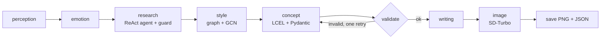

# 🌿 FLOREA — Nature Art Studio

[](https://github.com/ArwaKassebi/florea-nature-art-studio/actions/workflows/ci.yml)
[](https://colab.research.google.com/github/ArwaKassebi/florea-nature-art-studio/blob/main/notebooks/FLOREA_V6.ipynb)

**A photo, a sound, a few words (or any one of them) → an artwork, a poem, a short story.** *(Français : [README.md](README.md))*

FLOREA is a nature-inspired generative art studio built around a **LangGraph agent workflow**, a **local LLM (Qwen2.5) whose output is validated with Pydantic**, a **Graph-RAG** (knowledge graph + a **GCN written in NumPy**), **multimodal perception** (BLIP, AST, Whisper), **SD-Turbo** image generation, and an **MCP server** exposing its tools to Claude Desktop or Cursor.

## Architecture



## Highlights

| Problem | Solution |
|---|---|
| Small LLMs return sloppy JSON | Tolerant parser, then strict `FloreaConcept(BaseModel)` validation, low-temperature retry, field-by-field salvage with a valid fallback |
| Image prompts must be English, users write French | Pydantic validators, translated colors, mood from a whitelist |
| Small LLM does not always call its tool | ReAct agent decides; a guard runs the search otherwise and the trace says so |
| Vector RAG cannot explain its choices | Graph-RAG with human-readable paths (flower → emotion → style) |
| 5 models on a 15 GB GPU | `ModelManager`: on-demand loading, LRU eviction, explicit freeing |
| Tools locked in a notebook | Same functions exposed through an MCP server (5 tools) |

## Results

Link prediction on 20 % masked *entity → emotion* edges (mean AUC over 5 splits, 31 test links each; `evaluate_gcn()`):

| Method | AUC |
|---|---|
| **GCN (NumPy, 2 layers)** | **0.683** |
| Neighbour vote | 0.560 |
| Emotion popularity | 0.534 |

The GCN beats both baselines, but the test set is small (31 links): encouraging, not conclusive. **41 pytest tests** run in ~3 s with no GPU and no model download (GitHub Actions on every push).

## Quick start

```bash
pip install -r requirements-dev.txt && python -m pytest -q      # tests, no GPU
python mcp_server/demo_client.py                                 # MCP server + client demo
```

Full pipeline: open `notebooks/FLOREA_V6.ipynb` in Colab with a T4 GPU. Claude Desktop config:

```json
{"mcpServers": {"florea": {"command": "python", "args": ["/path/to/florea-nature-art-studio/mcp_server/florea_server.py"]}}}
```

## Limitations

Small 1.5B LLM (agent sometimes skips the tool, hence the guard); GCN has no node features, so on ~250 nodes it behaves mostly like matrix factorisation; hand-written knowledge base (70 notes, 64 entities); keyword-based emotion detection; no human evaluation of the artworks.

## Licenses

Code: MIT. Downloaded models keep their own licenses (SD-Turbo: Stability AI license with commercial-use conditions; Qwen2.5-3B: Qwen Research license; others permissive). Check each model card before any use beyond a demo.
