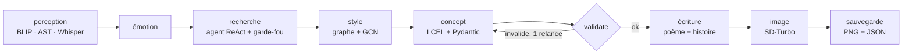

# 🌿 FLOREA — Nature Art Studio

[](https://github.com/ArwaKassebi/florea-nature-art-studio/actions/workflows/ci.yml)
[](https://colab.research.google.com/github/ArwaKassebi/florea-nature-art-studio/blob/main/notebooks/FLOREA_V6.ipynb)


**Une photo, un son, quelques mots (ou n'importe laquelle de ces entrées seule) → une œuvre, un poème, une histoire.**

FLOREA est un studio d'art génératif inspiré de la nature. Il combine un **agent LangGraph**, un **LLM local** (Qwen2.5) dont la sortie est **validée par Pydantic**, un **Graph-RAG** (graphe de connaissances + GCN écrit en NumPy), de la **perception multimodale** (BLIP, AST, Whisper), la génération d'image **SD-Turbo**, et un **serveur MCP** qui expose ses outils à Claude Desktop ou Cursor.

> 📸 *Ajoutez ici 2 ou 3 captures de l'interface dans `docs/` (onglet « Créer », accordéon « Pourquoi cette œuvre ? », galerie).*

## Ce que le projet démontre

| Compétence | Où dans le code |
|---|---|
| Orchestration d'agents (LangGraph, boucle de validation) | `src/florea/pipeline.py` |
| Sorties structurées fiables d'un petit LLM (Pydantic + LCEL) | `src/florea/text.py`, `src/florea/chain.py` |
| Tool calling et agent ReAct (`@tool`, `create_react_agent`) | `src/florea/chain.py` |
| RAG vectoriel (FAISS) **et** Graph-RAG explicable | `src/florea/kb.py` |
| GCN implémenté à la main (rétropropagation vérifiée par différences finies) | `src/florea/kb.py`, `tests/test_kb.py` |
| Serveur MCP (FastMCP) + client de démonstration | `mcp_server/` |
| Gestion de la mémoire GPU (chargement à la demande, éviction LRU) | `src/florea/mem.py` |
| Tests sans GPU, CI GitHub Actions | `tests/`, `.github/workflows/ci.yml` |

## Architecture



Les entrées (photo, son, texte) sont **toutes optionnelles** ; il en faut au moins une. Chaque œuvre sauvegarde un JSON avec le prompt exact, la trace de l'agent, les chemins du graphe et les temps par étape.

## Choix techniques : problème → solution

| Problème | Solution |
|---|---|
| Un petit LLM (1,5 Md de paramètres) renvoie du JSON approximatif | Parseur tolérant (`extract_json`) **puis** validation stricte par `FloreaConcept(BaseModel)` ; relance à basse température ; sinon récupération **champ par champ** avec un concept de secours valide par construction |
| Le prompt image doit être en anglais alors que l'utilisateur écrit en français | Validateurs Pydantic (sujet et palette en anglais), couleurs françaises traduites, ambiance dérivée d'une liste blanche (`EMOTIONS_FR`) |
| Le petit LLM n'appelle pas toujours l'outil de recherche | Agent ReAct : le modèle **décide** d'appeler `search_knowledge` ; un **garde-fou** lance la recherche si rien n'a été appelé, et la trace le dit |
| Un RAG vectoriel ne dit pas *pourquoi* un style est choisi | Graph-RAG : fleur/ambiance/son → couleur → saison → émotion → style ; chemins lisibles (« lavender évoque Nostalgie ») affichés dans l'interface |
| GPU de 15 Go (Colab T4) pour 5 modèles | `ModelManager` : chargement à la demande, éviction LRU, libération explicite (`del` + `empty_cache`) |
| Code difficile à tester | Tout ce qui n'est pas GPU (`styles`, `text`, `kb`, `mem`, `chain`) est testable ; le LLM est remplacé par des réponses scriptées dans les tests |
| Outils enfermés dans un notebook | Les mêmes fonctions sont exposées par un serveur MCP (5 outils) |

## Résultats

### GCN : prédiction de liens masqués

On masque 20 % des liens *entité → émotion*, on entraîne le GCN sur le reste, puis on mesure l'**AUC** (0,5 = hasard, 1 = parfait) contre deux références simples. Moyenne de 5 découpages, 31 liens de test par découpage (`evaluate_gcn()`, ~10 s sur CPU) :

| Méthode | AUC |
|---|---|
| **GCN (NumPy, 2 couches)** | **0,683** |
| Vote (entités voisines qui ont déjà cette émotion) | 0,560 |
| Popularité de l'émotion | 0,534 |

Le GCN fait mieux que les deux références, mais l'écart repose sur un **petit jeu de test** (31 liens) : c'est un signal encourageant, pas une preuve de généralisation.

### Tests

`pytest` : **41 tests**, ~3 s, aucun GPU ni téléchargement de modèle (ils tournent à chaque push via GitHub Actions).

### Performances d'exécution

Ordre de grandeur observé par l'auteur sur un GPU T4 : premier lancement 5 à 8 min (téléchargement des modèles), puis environ 20 à 40 s par œuvre. Ces temps ne sont pas mesurés par la CI.

## Structure du dépôt

```
florea-nature-art-studio/
├── src/florea/
│   ├── styles.py     # 44 styles artistiques, émotions, langues
│   ├── text.py       # FloreaConcept (Pydantic), JSON tolérant, couleurs, prompt image
│   ├── kb.py         # documents, entités, FAISS, graphe (Graph-RAG), GCN NumPy, évaluation
│   ├── mem.py        # ModelManager (LRU)
│   ├── chain.py      # LocalChat, chaînes LCEL, outils @tool, agent ReAct
│   ├── pipeline.py   # modèles GPU + workflow LangGraph (9 nœuds)
│   └── ui.py         # interface Gradio
├── mcp_server/       # serveur MCP + client de démonstration
├── notebooks/        # FLOREA_V6.ipynb (Colab)
├── tests/            # pytest
└── .github/workflows/ci.yml
```

## Installation et usage

### 1. Sur Google Colab (recommandé)

Cliquez sur le badge **Open in Colab**, choisissez *Exécution → Modifier le type d'exécution → GPU (T4)*, puis exécutez les cellules dans l'ordre. L'interface Gradio s'ouvre avec un lien public.

### 2. Lancer les tests en local (sans GPU)

```bash
git clone https://github.com/ArwaKassebi/florea-nature-art-studio.git
cd florea-nature-art-studio
pip install -r requirements-dev.txt
python -m pytest -q
```

### 3. Serveur MCP

```bash
pip install mcp numpy pydantic
python mcp_server/demo_client.py        # lance le serveur et appelle 2 outils
```

Pour Claude Desktop, dans `claude_desktop_config.json` :

```json
{
  "mcpServers": {
    "florea": {
      "command": "python",
      "args": ["/chemin/vers/florea-nature-art-studio/mcp_server/florea_server.py"]
    }
  }
}
```

Outils exposés : `search_knowledge`, `generate_image_prompt`, `list_styles`, `recommend_styles`, `explain_links`.
Sans `sentence-transformers`, la recherche utilise des embeddings hachés (lexicaux, moins précis) ; installez `sentence-transformers` et `faiss-cpu` pour la recherche sémantique.

## Limites 

- **Petit LLM** : Qwen2.5-1.5B n'appelle pas toujours l'outil de recherche (d'où le garde-fou) et écrit des poèmes corrects mais pas remarquables. Le modèle 3B améliore l'écriture (`init(llm_name=...)`).
- **GCN** : les nœuds n'ont pas d'attributs (`X = I`) ; sur ~250 nœuds, le modèle se comporte surtout comme une factorisation de matrice du graphe. Évaluation sur 31 liens de test seulement.
- **Base de connaissances** : 70 fiches nature et 64 entités rédigées à la main, centrées sur la flore méditerranéenne et tempérée ; pas de couverture exhaustive.
- **Détection d'émotion** : lexique de mots-clés (français/anglais), pas un classifieur.
- **Heuristique d'anglais** (`looks_english`) : liste de mots courants, donc imparfaite.
- **Image** : SD-Turbo en 4 étapes, 512×512 ; la fidélité au style d'un artiste est approximative.
- Pas d'évaluation humaine de la qualité des œuvres.

## Licences et crédits

Le code de ce dépôt est sous licence **MIT**. Les modèles téléchargés au premier lancement ont **leurs propres licences**, à vérifier avant tout usage au-delà de la démonstration :

| Modèle | Rôle | Licence (à vérifier sur la fiche Hugging Face) |
|---|---|---|
| `stabilityai/sd-turbo` | image | Licence Stability AI : usage commercial soumis à conditions |
| `Qwen/Qwen2.5-1.5B-Instruct` (et 0.5B) | texte | Apache 2.0 |
| `Qwen/Qwen2.5-3B-Instruct` | texte (option) | Licence Qwen Research, différente d'Apache 2.0 |
| `Salesforce/blip-image-captioning-base` | description de photo | BSD-3-Clause |
| `MIT/ast-finetuned-audioset-10-10-0.4593` | classification de sons | à vérifier sur la fiche du modèle |
| `openai/whisper-base` | transcription | MIT |
| `sentence-transformers/all-MiniLM-L6-v2` | embeddings | Apache 2.0 |

Les styles « à la manière de » sont de simples descriptions stylistiques pour un modèle de diffusion ; aucune œuvre d'artiste n'est reproduite ni utilisée comme donnée.

## Ce que j'ai appris

*(À adapter avec vos mots avant publication.)*

- Un petit LLM n'est fiable que si le code l'entoure : schéma strict, relance, repli champ par champ.
- Un agent doit avoir un garde-fou, et la trace doit dire quand il a été utilisé.
- Écrire un GCN à la main et vérifier ses gradients par différences finies aide à comprendre ce que fait vraiment une librairie.
- Séparer le code testable (sans GPU) du code GPU rend la CI possible.
